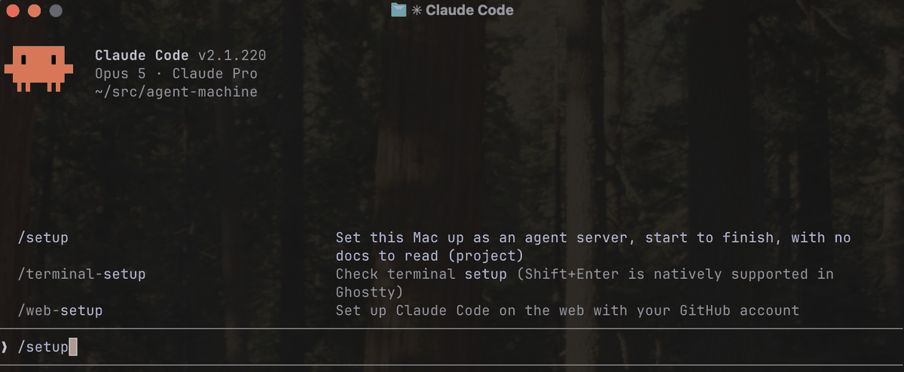

# agent-machine

Turn a spare Mac into an always-on server that runs coding agents, optionally running headless,
reachable from any device on your tailnet, with each agent sandboxed in its own microVM so they can
run in YOLO mode ("skip all permission prompts") safer.

WARNING: this project is suggested to be run with `claude --dangerously-skip-permissions`. It
also suggests that you turn off FileVault encryption if you want your server to auto restart.
You shouldn't proceed unless you understand the associated risks of these suggestions.

Agent isolation uses [Docker Sandboxes](https://docs.docker.com/ai/sandboxes/), which is
proprietary and needs a free Docker account. The host layer does not depend on it.

## Get it running

On your spare Mac with a monitor and keyboard (have a cheap HDMI dummy dongle on hand or on order
too if you plan to run 24/7 headless):

```
git clone https://github.com/techpunch/agent-machine.git ~/agent-machine && cd ~/agent-machine
claude --dangerously-skip-permissions
```

Then in claude run `/setup`:



That's it! `/setup` asks what end state you want your machine in, and does as much of the
heavy lifting for you as it can to get you to your desired state, asking you for things
along the way only when it needs to.

You can stop reading now if you'd like and just do it.

## What `/setup` does

It's a conversation that gets you to your end goal machine state as quickly as possible.

Before it starts, it tells you what it needs from you, and only what it needs given what you
picked — a Tailscale key, your admin password, a Docker account for the agent sandboxes, a Claude
subscription, an HDMI dummy plug if you want the machine headless. It installs everything else
itself.

It proves the server survives a reboot untouched *before* it tells you it is safe to unplug the
keyboard and swap the monitor for the dongle.

Run it again any time. It re-checks everything, offers only what is still missing, and re-running a
finished step is a no-op.

## Setup options (multi-select)

| | |
|---|---|
| Reach it from anywhere | SSH and screen sharing over Tailscale, no ports opened |
| Keep running unattended | Never sleeps, comes back by itself after a power cut |
| Run with no monitor or keyboard | Proves reboot survival first, then you unplug |
| Route your traffic through it | Use it as a Tailscale exit node on untrusted wifi |
| Run coding agents on it | WIP - A microVM per agent, egress under policy, nothing shared with the Mac |
| Drive many projects at once | WIP - A persistent terminal grid you attach to from anywhere |

## Keep a copy of the details off the server

The server carries its own record — config in `~/.agent-machine/server.env`, what is applied in
`server.md`, and a full history of every action in `run.log`. That is deliberate; there is no central
inventory to drift.

But all three are on the box you would be trying to rebuild. Keep a human copy somewhere else: the
machine's name and Tailscale IP, the admin user, whether FileVault is off, which password-manager
entry holds your tailnet key — pointers, never the secrets themselves — and how to revoke everything
if the Mac is stolen. `/setup` offers to print it for you at the end. Put it in your password manager
or a note on your laptop; not in this repo, and never inside an agent sandbox.

## More

In case you're curious to know more about how it works and the internals:

- [`docs/running-the-cookbook.md`](docs/running-the-cookbook.md) — driving it yourself without
  `/setup`, and reading the records it leaves behind.
- [`docs/secrets-and-egress.md`](docs/secrets-and-egress.md) — what may live in a sandbox, and why yolo
  mode on the Mac itself is only for this repo. Read before putting a project in there.
- [`docs/pushing-agent-code.md`](docs/pushing-agent-code.md) — getting the agent's work out of a
  sandbox and pushed, without a credential that can reach your real branches.
- [`docs/host-agent-design.md`](docs/host-agent-design.md) — why the host and the agents are separate.
- [`docs/shared-setup.md`](docs/shared-setup.md) — accounts and tailnet, once before the first server.
- [`CLAUDE.md`](CLAUDE.md) — repo layout and how to write a recipe.

Not built yet: encryption at rest that survives an unattended reboot. It carries a contract in
`recipes/make-data-encrypted/` explaining what it is waiting on.

## License

[MIT](LICENSE). Provided as is, with no warranty of any kind — which is worth reading rather than
skipping past, given this configures your machine as root, runs agents with permissions skipped, and
turns off disk encryption. You are responsible for what you run it on.
